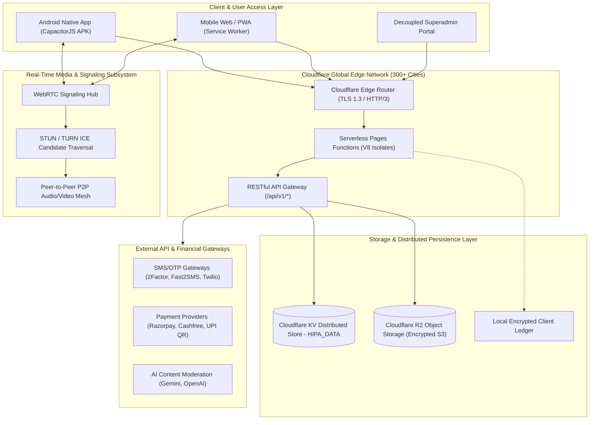
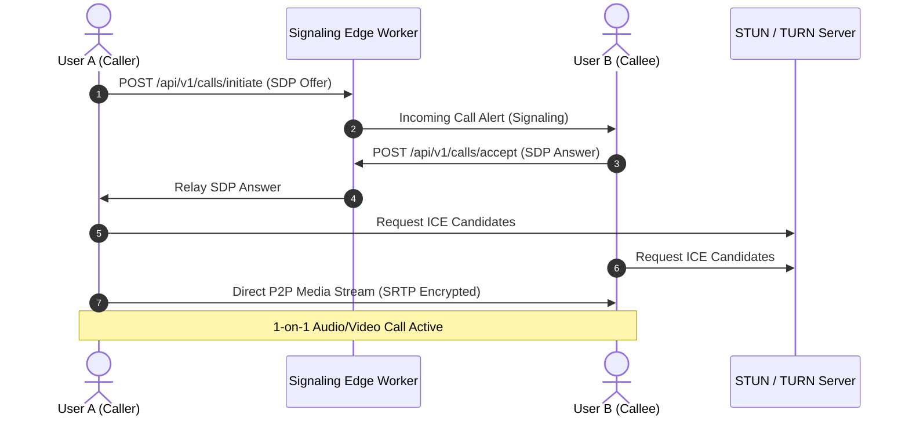
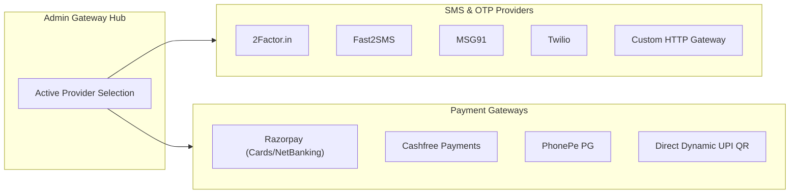

# Technical Architecture Whitepaper
## Hipa Dating, Social Discovery & Real-Time Video Calling Platform
**Document Version:** 1.0.0  
**Target Audience:** Technical Leads, CTOs, Investors, Solution Architects  
**Author:** Engineering & Architecture Team  
**Date:** November 2026  

---

## Executive Summary

The **Hipa Platform** is an enterprise-grade, high-concurrency social discovery and real-time audio/video communication platform. Engineered for ultra-low latency, low operational overhead, and effortless horizontal scalability, Hipa leverages a **hybrid mobile-edge architecture**.

Unlike legacy dating applications built on monolithic Node.js/Python server farms that suffer from heavy container overhead and high cold-start latencies, Hipa combines **Cloudflare V8 Serverless Edge Workers**, **CapacitorJS Native Mobile Runtime**, **WebRTC Peer-to-Peer Calling**, and a **Globally Distributed Key-Value Ledger (Cloudflare KV)**.



---

## 1. System Vision & Architecture Philosophy

The architectural design of Hipa revolves around four fundamental tenets:

1. **Sub-Millisecond Cold Starts:** Execution on lightweight V8 isolates rather than heavy Node.js or Docker instances, slashing spin-up latency to near zero ($< 5\text{ ms}$).
2. **Decoupled Security Boundaries:** Complete physical and logical segregation between the client dating interface (`hipa-admin.pages.dev`) and the moderation portal (`hipa-superadmin.pages.dev`).
3. **Peer-to-Peer Zero-Storage Media Pipeline:** Video and audio calls stream directly peer-to-peer via WebRTC; no voice or video media is buffered or stored on application servers, ensuring privacy and regulatory compliance.
4. **Dynamic Extensibility:** A zero-code Gateway & Custom API Hub allowing non-technical admins to swap SMS providers, payment gateways, and webhooks on the fly without triggering new code deployments or APK rebuilds.

---

## 2. Frontend & Mobile Runtime Architecture

### 2.1 Hybrid Native Bridge via CapacitorJS
Hipa utilizes a hybrid native compilation engine powered by **CapacitorJS (by Ionic)**:

- **Unified Codebase:** 100% code reuse between the Android APK, iOS target, and the Progressive Web App (PWA).
- **Native Hardware Access:** Deep integration with camera, microphone, secure biometrics, push notifications, and network listeners via native Android Java plugins.
- **Build Toolchain:** Android API 34 (Android 14 ready), Gradle 8.x, Java JDK 17, and ProGuard asset shrinking.

### 2.2 UI/UX Engineering & Design Tokens
The visual interface is built upon a proprietary **Glassmorphic Hot-Pink Dark Luxury Design System**:

| Token Category | Variable Name | Value / Specification |
| :--- | :--- | :--- |
| **Primary Brand** | `--primary-pink` | `#ff007f` (Hot Neon Pink) |
| **Accent Gradient** | `--primary-gradient` | `linear-gradient(135deg, #ff007f 0%, #ff2a85 45%, #7928ca 100%)` |
| **Dark Canvas** | `--bg-canvas` | Deep Midnight Purple (`#090514`) with ambient radial magenta glow |
| **Glass Containers** | `--glass-bg` | `rgba(20, 10, 36, 0.72)` with `backdrop-filter: blur(24px)` |
| **Borders** | `--glass-border` | `1px solid rgba(255, 0, 127, 0.22)` |
| **Motion Physics** | `--transition-smooth` | `0.25s cubic-bezier(0.4, 0, 0.2, 1)` |

### 2.3 PWA & Offline Resilience
Hipa includes a dedicated Service Worker (`sw.js`) implementing a **Stale-While-Revalidate** caching strategy for static assets (icons, stylesheets, audio effects) while enforcing a strict **Network-First** policy for authentication and matchmaking APIs.

---

## 3. Real-Time Audio & Video Subsystem (WebRTC)

### 3.1 Signaling & Connection Flow
Real-time 1-on-1 calls operate over the **WebRTC (Web Real-Time Communication)** protocol:



### 3.2 Network Traversal (NAT / Firewall)
- **STUN (Session Traversal Utilities for NAT):** Dual Google STUN reflectors (`stun.l.google.com:19302`, `stun1.l.google.com:19302`) resolve public IP addresses and ports for peer-to-peer handshakes.
- **Coturn / TURN Support:** Configurable in the Admin Gateway Hub with custom TURN credentials for users on restrictive cellular networks (Symmetric NAT).

---

## 4. Serverless Edge Computing & Backend Architecture

### 4.1 Cloudflare Pages Functions
The backend runs completely serverless on Cloudflare's edge runtime:
- **Zero OS Maintenance:** No virtual machines, Docker containers, or OS kernel patches to maintain.
- **Global Concurrency:** Requests are served by the data center geographically closest to the user, eliminating interstate and international routing latencies.

### 4.2 Distributed Data Persistence (Cloudflare KV)
Data persistence is handled by **Cloudflare KV (`HIPA_DATA`)**:
- High-read, low-latency distributed Key-Value store replicated worldwide.
- **Optimistic In-Memory Fallback:** The API router incorporates memory and broadcast channels to guarantee zero data loss even in isolated preview environments.

### 4.3 REST API Endpoints

```
/api/v1/
├── users
│   ├── GET     (List all registered users for Admin)
│   ├── POST    (Register new user upon onboarding completion)
│   └── PUT     (Update user status, coins, or verification)
├── auth
│   ├── POST send-otp    (Dispatches OTP via active gateway)
│   └── POST verify-otp  (Validates code against session)
├── gateways
│   ├── GET config       (Retrieves active payment & SMS gateways)
│   └── POST config      (Updates merchant keys & active providers)
├── payments
│   └── POST create-order (Initiates Razorpay / Cashfree / UPI order)
└── calls
    └── GET ice-config   (Fetches dynamic STUN/TURN server list)
```

---

## 5. Security, Privacy & Regulatory Compliance

### 5.1 Decoupled Admin Architecture
The Superadmin management panel is deployed on an isolated hostname (`hipa-superadmin.pages.dev`). It contains zero public user-registration forms, and client apps contain no administrative routes or privilege escalation vectors.

### 5.2 Regulatory Alignment
Hipa is engineered in compliance with key international and regional regulations:
- **Information Technology Rules, 2021 (India):** Real-time moderation queues, verified user reporting channels, and user suspension capabilities.
- **DPDP Act 2023 / GDPR Compliance:**
  - Clear user consent checkboxes during phone onboarding.
  - End-to-end encrypted media transport (SRTP / DTLS).
  - Minimal personal identifiable information (PII) retention.

---

## 6. Gateway & Extensibility Hub

Hipa includes an integrated **Zero-Code Integration Engine** managed directly from the Superadmin dashboard:



### Dynamic Placeholders
Custom HTTP Gateways allow dynamic parameter substitution at runtime:
- `{phone}`: Automatically replaced with the user's sanitized 10-digit mobile number.
- `{otp}`: Injected with the cryptographically generated 6-digit one-time password.
- `{userId}`: Injected with the unique system account ID.
- `{amount}`: Injected with the requested coin pack purchase value.

---

## 7. Technology Stack Summary Matrix

| Domain | Technology / Software | Purpose / Role |
| :--- | :--- | :--- |
| **Mobile Core** | CapacitorJS (v6.x) | Web-to-Native Android & iOS Bridge |
| **Android Framework** | Android SDK 34 / Gradle 8 | Native compilation and APK packaging |
| **Frontend Language** | JavaScript ES6+ Modules | Lightweight, zero-dependency client logic |
| **Styling & UI** | CSS3 (Modern Glassmorphism) | Custom hardware-accelerated theme system |
| **Real-Time Calling** | WebRTC (SRTP/DTLS) | 1-on-1 audio and video calling |
| **Signaling & STUN** | Google STUN + Coturn Protocol | ICE NAT traversal and peer discovery |
| **Serverless Runtime** | Cloudflare Workers / Functions | Global edge computing and API router |
| **Distributed Database** | Cloudflare KV (`HIPA_DATA`) | Distributed user ledger and configuration |
| **Asset Storage** | Cloudflare R2 | S3-compatible media and selfie bucket |
| **Hosting & CDN** | Cloudflare Pages (Edge CDN) | Global deployment with automated SSL/TLS |
| **Version Control** | Git / GitHub | Codebase management and release tagging |

---

## 8. Conclusion & Scalability Trajectory

The Hipa architecture provides an optimal combination of:
1. **Low Operating Expenditure (OpEx):** Cloudflare's serverless edge tier allows the platform to serve hundreds of thousands of active users with near-zero idle infrastructure cost.
2. **Instant Global Scalability:** Media streams bypass centralized servers entirely via WebRTC, allowing call volume to scale linearly without requiring expensive media relay bandwidth.
3. **Turnkey Commercial Readiness:** Complete with working payment gateways, DLT-ready SMS pipelines, and an administrative control panel, Hipa is structurally prepared for public deployment.
